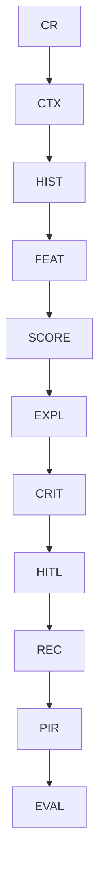

# ChangeGuard — Design

## Flow
CR → collect (MCP: CI/blast radius/schedule/collisions) → retrieve (hybrid
mock RAG over past changes + linked incidents) → features (9, code) →
score (weighted rules → lane) → explain (mock gateway template) → critic
(grounding, code) → interrupt for CAB → record → PIR outcome → eval.

## Retrieval (P1 reuse)
Scope filter (same CI or dependents) → two rankings: hash-embedding cosine
(`mock_embed`, dim 64) and keyword Jaccard → RRF fuse (k=60). Returns linked
incidents for caused-incident neighbours. No vector DB (offline slice).

## Features (9)
blast_radius_size · ci_criticality · collision_count(±2h) · freeze_window ·
rollback present/tested · past_failure_rate (top-5 similar) · window_risk ·
requester_fail_rate · test_evidence.

## Scoring
Weighted sum capped at 100 (see `WEIGHTS` in scoring.py); lanes
standard <35 / needs-CAB 35–65 / reject-back ≥65. Thresholds from env.
Why rules not ML: ADR-001.

## Graph (P4 reuse)
Own tiny sync graph (`graph.py` ORDER list); interrupt = record stored as
`pending` until CAB posts approve/reject/request-info. MCP stubs in
`mcp_tools.py` (reads open; `add_change_note` approval-gated).

## Gateway (P5 reuse)
Single client `gateway.py`; mock model renders a fixed template; every call
records tokens/latency/cost; per-assessment + per-run caps enforced.

## Eval (P2 reuse)
Time split (older 70% tune / newer 30% test — no peeking). Precision/recall/F1
high-risk vs bad outcome, confusion matrix, 10:1 FN:FP cost view, grounding
rate, $/latency per CR, critical-CI baseline.
